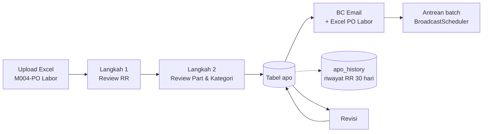

<div align="center">

# 📮 Masterhub System

**Pusat monitoring case dan pengiriman email massal (BC Email) untuk operasional servis.**
Upload sheet Excel, validasi otomatis, lalu kirim laporan ke setiap perusahaan lewat antrean yang aman.


[Fitur](#-fitur) · [Alur PO Labor](#-alur-po-labor) · [Instalasi](#-instalasi) · [Testing](#-testing) · [Struktur](#-struktur-proyek)

<!-- Ganti dengan screenshot asli: simpan di docs/screenshots/ -->
<!--  -->

</div>

---

## ✨ Fitur

| | |
|---|---|
| 📥 **Upload Sheet** | Impor Excel untuk 10 jenis monitoring: WIP, TAT 5 hari, TAT 14 hari, KCI, Finish Repair, MPR, Reminder Invoice, Pembayaran, KLA, dan PO Labor. |
| 💰 **PO Labor otomatis** | Labor dihitung per case dari sheet *Parts* dan *Transaction Report*, lengkap dengan popup review part dan kategori. |
| 🔁 **Deteksi RR (Re Repair)** | Serial No sama dalam satu file, dan lintas bulan dengan jendela **30 hari** dari riwayat. |
| ✏️ **Revisi tanpa upload ulang** | Buka data PO Labor terakhir yang belum terkirim, koreksi, lalu simpan. |
| 📧 **BC Email** | Pratinjau dan kirim email per perusahaan memakai template dan footer yang bisa diedit (Summernote). |
| 📣 **Broadcast All** | Kirim massal ke banyak perusahaan sekaligus. |
| ⏱️ **Antrean batch global** | Pengiriman dijadwalkan per batch dengan jeda, dan dua pengiriman yang diklik hampir bersamaan tidak menabrak jadwal (`lockForUpdate`). |
| 🗂️ **Data master** | Email Master, Template, Footer, User, PN Master, dan Sparepart Master (kategori dan harga labor IPG/PSG). |
| 📊 **Dashboard dan Raw Data** | Ringkasan case dan ekspor data mentah. |
| 🔐 **Login berbasis peran** | Halaman utama hanya untuk user yang sudah login, dengan middleware admin untuk menu tertentu. |

## 🔄 Alur PO Labor



Aturan utama yang diterapkan saat Labor dihitung:

- Part yang menentukan Labor adalah part berstatus **Defective** yang paling awal di-order (atau part yang dipilih manual di popup).
- **Out Warranty** tidak dimasukkan, kecuali kode **511** dengan status *Sales Delay* (Labor flat).
- **Printer** dihitung sebagai *Simple Repair*, dan **Whole Unit** sebagai *Replace Unit*.
- **Close Repair tanpa part** mendapat kategori *Rebuild, Re install, Recovery*.
- **Cancel** dan **Void Case** tanpa Labor.
- **RR** (case ke-2 dan seterusnya per Serial No, atau case yang masih dalam 30 hari setelah case lama ditutup) tanpa Labor, kecuali dipilih *Dapat Labor*.

## 🧰 Teknologi

- **Backend:** PHP 8.1+, Laravel 10, Laravel Sanctum
- **Excel:** [Maatwebsite Excel](https://laravel-excel.com/) (PhpSpreadsheet)
- **Database:** MySQL 8
- **Antrean dan email:** Laravel Queue dan Mail (`jobs`, `job_batches`, `failed_jobs`)
- **Frontend:** Blade, Summernote (editor template email)
- **Kualitas kode:** PHPUnit 10, Larastan, Laravel Pint

## 🚀 Instalasi

**Prasyarat:** PHP 8.1+ (ekstensi `zip`, `gd`, `mbstring`, `pdo_mysql`), Composer, MySQL 8. Di Windows, [Laragon](https://laragon.org/) sudah cukup.

```bash
# 1. Ambil kode
git clone https://github.com/<username>/masterhub.git
cd masterhub

# 2. Pasang dependensi
composer install

# 3. Konfigurasi
cp .env.example .env
php artisan key:generate
```

Isi koneksi database dan email di `.env`:

```env
DB_DATABASE=masterhub
DB_USERNAME=root
DB_PASSWORD=

QUEUE_CONNECTION=database
MAIL_MAILER=smtp
```

```bash
# 4. Siapkan database
#    Buat database "masterhub", lalu impor struktur tabel (masterhub.sql)
#    lewat phpMyAdmin atau: mysql -u root masterhub < masterhub.sql

# 5. Jalankan
php artisan serve
php artisan queue:work      # worker pengiriman email, jalankan di terminal terpisah
```

> ⚠️ Tabel seperti `apo`, `apo_history`, `labor_categories`, `part_master`, dan `sparepart_master` dibuat dari `masterhub.sql`, bukan dari `php artisan migrate`.

### Menjalankan sebagai service (Windows)

Worker memakai kode yang dimuat saat service dijalankan. Setelah mengubah kode, restart:

```powershell
nssm restart NAMA_SERVICE
```

## 🧪 Testing

Tes memakai **database terpisah** supaya data asli aman.

1. Buat database kosong `masterhub_test` dan impor struktur dari `masterhub.sql`.
2. Salin `.env` menjadi `.env.testing`, lalu ubah:

   ```env
   APP_ENV=testing
   DB_DATABASE=masterhub_test
   MAIL_MAILER=log
   QUEUE_CONNECTION=sync
   ```

3. Jalankan:

   ```bash
   php artisan config:clear
   php artisan test --testsuite=Feature
   vendor/bin/phpstan analyse --memory-limit=1G
   ```

Cakupan tes saat ini: upload PO Labor, aturan RR 30 hari, revisi PO Labor, penjadwal batch, login, dan penjagaan route.

> 🛡️ Tes akan **berhenti otomatis** kalau database aktif namanya tidak berakhiran `_test`. Upload PO Labor menjalankan `TRUNCATE` pada tabel `apo`, jadi pengaman ini mencegah data asli terhapus.

## 📁 Struktur proyek

```text
app/
├── Exports/                  # Excel PO Labor, Raw Data
├── Http/Controllers/
│   ├── ImportController.php  # upload, RR, revisi
│   ├── EmailController.php   # BC Email
│   ├── BroadcastController.php
│   └── Concerns/             # trait: HandlesRrHistory, HandlesPoLaborRevision, ...
├── Imports/                  # ApoImport, ApoPartsImport, MultiSheetImport, ...
├── Jobs/                     # SendBcEmailJob, SendBroadcastEmailJob
├── Models/
├── Services/                 # PartCategoryResolver, PartLaborMapping, CompanyMapping
└── Support/                  # BroadcastScheduler, CompanyGroup
resources/views/              # halaman Blade (dashboard, import, bulk, master data)
tests/
├── Feature/                  # tes upload, RR 30 hari, revisi, login
└── Support/                  # pembuat file Excel uji
```

## 🔒 Catatan keamanan

- Jangan commit `.env`, `.env.testing`, atau file `.sql` berisi data asli.
- Password SMTP per user disimpan di `user_masters.smtp_password`. Pertimbangkan enkripsi sebelum dipakai di server publik.
- Periksa route di luar grup `auth` di `routes/web.php` (mis. `/upload/resolve-parts`) dan pastikan memang sengaja terbuka.

## 🗺️ Roadmap

- [ ] Tes tampilan dengan Laravel Dusk (login, Review RR, Dashboard)
- [ ] Menurunkan temuan Larastan sampai tanpa baseline
- [ ] Menyatukan struktur database ke migrations

## 📄 Lisensi

Proyek internal. Tentukan lisensi sebelum dipublikasikan (mis. MIT) dan tambahkan file `LICENSE`.
